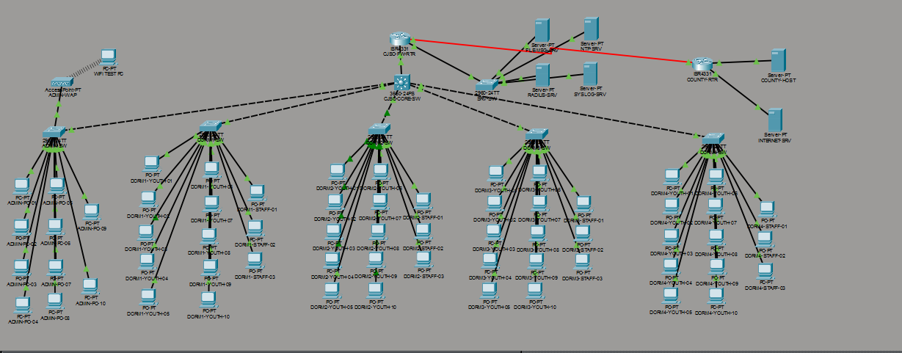

# Campus Network Design – Cedarview Juvenile Services Center

Design and implementation of a secure, segmented campus network for a fictional county juvenile services facility, built and tested in Cisco Packet Tracer 9.0.

## Overview

Cedarview Juvenile Services Center (CJSC) has an administration building, four residential dorms, and a server room. The network had to give administrative and dorm staff full access to internal and county resources, give guests internet-only access, and limit youth residents to an approved internal file and messaging server with no internet access at all.

## Design Goals

- Separate administrative staff, dorm staff, staff Wi-Fi, guests, and youth residents into their own networks
- Block youth devices from the internet and from every internal system except the approved file/messaging server
- Keep guest traffic away from all internal and county networks
- Connect staff securely to the county network over an encrypted site-to-site VPN
- Centralize addressing, logging, and time so the network is easy to support and audit

## Topology

| Device | Model | Role |
|--------|-------|------|
| CJSC-FW-RTR | Cisco ISR 4331 | Edge router: inter-VLAN routing, DHCP, NAT, ACLs, IPsec VPN |
| CJSC-CORE-SW | Cisco Catalyst 3650 | Core/distribution switch, spanning-tree root |
| ADMIN-SW | Cisco Catalyst 2960 | Administration building access switch and wireless uplink |
| DORM1-SW – DORM4-SW | Cisco Catalyst 2960 | Dorm access switches (youth and dorm staff ports) |
| SRV-SW | Cisco Catalyst 2960 | Server room switch |
| ADMIN-WAP | Access point | Guest wireless (CJSC-Guest SSID) |
| COUNTY-RTR | Cisco ISR 4331 | Simulated county network and VPN peer |

The design serves 10 administrative PCs, 40 youth PCs and 12 dorm staff PCs across the four dorms, plus five servers.

## Network Segmentation

| VLAN | Name | Subnet | Gateway | Access |
|------|------|--------|---------|--------|
| 10 | Admin | 10.10.0.0/24 | 10.10.0.1 | Internet, servers, county network over VPN |
| 20 | Guest | 10.20.0.0/24 | 10.20.0.1 | Internet only |
| 30 | Staff Wi-Fi | 10.30.0.0/24 | 10.30.0.1 | Internet and internal |
| 40 | Youth | 10.40.0.0/24 | 10.40.0.1 | File/messaging server only, no internet |
| 50 | Dorm Staff | 10.50.0.0/24 | 10.50.0.1 | Internet, servers, county network over VPN |
| — | Servers | 10.0.0.0/24 | 10.0.0.1 | Routed server segment |

**Servers:** file/messaging (10.0.0.10), RADIUS (10.0.0.20), NTP (10.0.0.30), syslog (10.0.0.40)

## Implementation

- **Switching:** 802.1Q trunks from the core switch to each building, with only the VLANs each building needs allowed on its trunk (admin building: 10, 20, 30; dorms: 40, 50)
- **Spanning tree:** Rapid PVST+ with the core switch set as root bridge for every VLAN; PortFast on end-device ports and BPDU Guard on the core switch's edge port
- **Routing:** router-on-a-stick inter-VLAN routing on the ISR 4331, with a default route to the county/ISP link
- **Addressing:** a DHCP pool for each VLAN on the router, with the first 49 addresses of each subnet reserved for infrastructure
- **NAT:** PAT overload on the WAN interface for internet-bound traffic; VPN traffic is exempted from NAT, and the youth VLAN is never translated
- **Site-to-site VPN:** IPsec (IKE phase 1 with AES and pre-shared key, ESP-AES with SHA-HMAC) carrying admin and dorm staff traffic to the county network (172.16.0.0/24)
- **Access control:**
  - `YOUTH-BLOCK` lets youth devices reach only the file/messaging server and DHCP, and drops all other traffic
  - `GUEST-RESTRICT` denies guest access to all private address ranges and permits internet traffic only
- **Device hardening:** local AAA login authentication, named admin accounts, and SSH version 2 on the edge router; enable secrets, password encryption, and authorized-use MOTD banners on the routers and switches
- **Monitoring:** every device sends logs to the central syslog server and syncs time from the NTP server

## Testing and Verification

- Confirmed DHCP assignment in each VLAN from the correct pool
- Verified admin and dorm staff hosts could reach the internet, the servers, and the county host across the VPN
- Confirmed youth hosts reached the file/messaging server but were blocked from the internet and other internal networks
- Confirmed guest hosts reached the internet but were blocked from internal and county networks
- Checked trunks, VLAN assignments, spanning-tree root, NAT translations, and the IPsec tunnel with `show` commands

## Repository Contents

| File | Description |
|------|-------------|
| `cedarview-campus.pkt` | Complete network (open with Cisco Packet Tracer 9.0 or later) |
| `images/Topology.png` | Network topology diagram |
| `configs/` | Running configuration for each router and switch (passwords and keys removed) |

## Skills Demonstrated

Network design · VLAN segmentation · Trunking · Rapid PVST+ · Inter-VLAN routing · DHCP · NAT/PAT · IPsec site-to-site VPN · Extended ACLs · AAA and device hardening · Syslog and NTP · Testing and documentation
